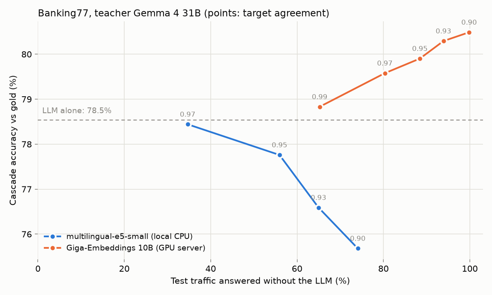

# bounded-distill

**Distill your LLM classifier into a small, fast model — with a statistical bound on agreement.**

> **Status: alpha.** The offline core works and is tested, but it is not on PyPI yet:
> version 0.0.1 there is a name placeholder. The API may still change before 0.1.0.

## The problem

Many teams classify text with an LLM pipeline: a prompt, a provider, output parsing.
It works, but every call is slow and costs money. A common fix is to train a small
classifier on the LLM's own labels and fall back to the LLM only when the small model
is unsure.

Training that classifier is easy. Deciding **when it is safe to trust it** is the hard
part. Nobody wants to replace an LLM in production on the basis of "it looked fine on
a validation set".

## What bounded-distill does

You give it texts and the labels your LLM already produced (for example, from your
logs). You state a target, such as *"agree with the LLM at least 97% of the time"*.
bounded-distill:

1. trains a small classifier (frozen sentence embeddings + logistic regression);
2. picks a confidence threshold so that the **lower confidence bound** of agreement on
   the texts it answers meets your target — not just the point estimate;
3. reports how much traffic the small model can take over (the share of LLM calls
   saved), per-class agreement and the small model's latency;
4. lists **suspects**: texts where the small model is confident but disagrees with the
   LLM. These are often LLM labeling mistakes and point to ambiguous class definitions
   in your prompt;
5. checks accuracy against a small human-labeled (gold) set, if you have one.

Texts below the threshold go back to your own LLM pipeline. The library never calls an
LLM itself.

## Install

Until the 0.1.0 release, install from a clone of the repository:

```bash
pip install .
```

The default embedder uses `sentence-transformers`, which needs PyTorch. On a machine
without a GPU, install the CPU-only build first to avoid a multi-gigabyte download:

```bash
pip install torch --index-url https://download.pytorch.org/whl/cpu
```

## Quickstart

```python
from bounded_distill import distill

# texts and the labels your LLM pipeline gave them, e.g. from your logs
router = distill(texts, llm_labels, target_agreement=0.97)

if (label := router.predict(text)) is None:   # not confident enough
    label = my_llm_pipeline(text)

print(router.report())
for suspect in router.suspects(top_n=20):
    print(suspect)

router.save("router/")                         # later: Router.load("router/")
```

`llm_labels` may contain `None` or empty strings (failed calls, parsing errors): they are
excluded, counted in the report, and a warning tells you how many. Pass
`on_invalid="drop"` to skip the warning or `on_invalid="error"` to fail instead. Pass
`labels=[...]` to fix the label set; then labels outside it are invalid too.

The default embedder is `intfloat/multilingual-e5-small` (many languages, runs on CPU).
To use your own vectors, pass `embed=`: any function from a list of texts to an
`(n, dim)` array.

## Reading the report

On synthetic data with 3% wrong LLM labels and a 90% target (made with a fake embedder,
so the latency is unrealistically low):

```
bounded-distill report
  texts:      900 total, 898 used, 2 invalid (1 missing (None), 1 empty)
  target:     agreement >= 90.0% at 95% confidence: reached
  threshold:  0.8218
  coverage:   53.6% (481 of 898 texts answered without the LLM)
  agreement:  92.3% on answered texts, lower bound 90.1%
  latency:    0.02 ms per text (median, student)

  per class  support  coverage  agreement
  billing        299     55.5%      95.8%
  other          297     52.2%      89.0%
  tech           302     53.0%      91.9%

  confident disagreements (LLM label -> student label)
  other -> tech         9
  other -> billing      8
  ...
```

- **coverage** is the share of traffic the small model answers, so it is also the share
  of LLM calls you save.
- **lower bound** is what the threshold is chosen by: with 95% confidence, agreement on
  the answered texts is at least this. If no threshold can guarantee the target, the
  router answers nothing and the report says so — it does not silently lower the bar.
- **per class** shows what the overall number hides: here `other` is below the target
  even though the total is above it.
- **confident disagreements** point at class definitions the LLM finds ambiguous —
  typically a catch-all class like `other`.

All numbers are out-of-fold estimates: each text is scored by a model that did not see
it during training. `print(...)` is for people; `report.to_dict()` gives plain JSON.

Suspects list single texts, most confident first. In this example 8 of the top 10 are
labels that were deliberately broken, although they are only 18% of all disagreements:

```
#90  tech -> billing (96.8%): 'billing 90'
#359  other -> tech (96.5%): 'tech 59'
```

The number is the position in your input, so you can find the row in your own data.

## Checking against gold labels

Agreement with the LLM is not accuracy. If you have a few hundred human-labeled texts
that were not used for training, compare the LLM, the small model and the cascade:

```python
print(router.evaluate(texts, gold_labels, llm_labels))
```

The small model only answers texts it is confident about, which tend to be the easier
ones, so its accuracy is shown next to the LLM's accuracy **on the same texts**.

## Benchmark: Banking77 with real LLM labels

Banking77 has 77 fine-grained intents of online banking queries (10,003 train and 3,080 test
texts) with human labels. The teacher is **Gemma 4 31B**, self-hosted on vLLM, prompted
zero-shot with the label names and constrained to answer with one of them. Its labels are
noisy, as in production: **78.5% accuracy** on test against the human labels.

`distill()` is trained on the LLM's train labels only. The human labels are used only to
evaluate, on test texts the router never saw.

<picture>
  <source media="(prefers-color-scheme: dark)" srcset="benchmarks/results/banking77_dark.png">
  
</picture>

At `target_agreement=0.97`:

| Embedder | Test traffic without the LLM | Agreement with the LLM on it | Cascade accuracy | Latency per text |
|---|---|---|---|---|
| multilingual-e5-small (default, local CPU) | 34.7% | 97.2% | 78.4% | 13 ms |
| Giga-Embeddings 10B (GPU server, via `embed=`) | 80.3% | 97.0% | 79.6% | 56 ms |
| *the LLM alone* | 0% | — | 78.5% | 117 ms |

- **The promise holds on unseen texts.** Measured agreement on test is at the target for
  every target with Giga-Embeddings; with e5-small it is 0.2–0.4 points below the target at
  0.93 and 0.95, within the sampling error of about ±1 point.
- **Coverage on test is higher than the out-of-fold estimate** (e.g. 34.7% vs 24.7%): the
  final model is refit on all data and is more confident. The estimate errs on the safe side.
- **The embedder decides the coverage.** A stronger embedder answers 2–3 times more traffic at
  the same target, and its cascade is slightly *more* accurate than the LLM alone: averaging
  over similar texts smooths the teacher's random errors.
- **Suspects find real LLM errors.** With Giga-Embeddings, 75 of the top 100 suspects are
  texts the LLM labeled wrongly (3× the 24% base rate), and in two of three the small model
  suggests the human label. With e5-small the signal is weaker (39 of 100).
- **About two thirds of the LLM's errors are systematic**: the small model learns them and
  agrees, so no agreement metric can reveal them. Only a gold set can — see `evaluate()`.

Caveats: one dataset and one teacher so far. Banking77 is part of MTEB, and embedders tuned
on MTEB training data may have seen it; the training data of Giga-Embeddings is not
published, so its numbers may be optimistic. Latencies depend on hardware: the LLM server
here is fast, so the main saving is GPU compute rather than time. Texts were embedded as they
are, without the instruction prefix Giga-Embeddings recommends for classification.
How to reproduce: [benchmarks/README.md](benchmarks/README.md).

## How it works

1. Embed the texts with a frozen sentence embedder.
2. Get out-of-fold class probabilities with k-fold logistic regression.
3. For each candidate threshold, count the covered texts and those where the small model
   agrees with the LLM; compute the one-sided Wilson lower bound of agreement.
4. Pick the lowest threshold (the most coverage) whose bound reaches the target.
5. Refit on all data. Prediction is one embedding plus a matrix product in numpy.

A saved router is a JSON file and a `.npz` file — no pickle, and no training texts on
disk. The design is described in [HLD/offline_core.md](HLD/offline_core.md).

## How it differs from similar tools

Several projects distill an LLM classifier into a small model with an LLM fallback.
bounded-distill focuses on:

- **Offline first.** Works on labels you already have; it does not run or wrap the LLM.
- **A statistical bound**, not a hand-picked threshold.
- **Auditing the teacher.** Confident disagreements surface LLM labeling errors
  (in the spirit of Confident Learning, Northcutt et al., 2021).
- **Small and simple.** One function call, strict typing, few dependencies.

## Honest limitations

- Agreement with the LLM is not accuracy. If the LLM makes the same mistake
  consistently, the small model learns it too. Use a gold set to check.
- The threshold is chosen and evaluated on the same out-of-fold data, so the bound is
  slightly optimistic.
- Single-label classification with a fixed, known set of labels only.
- When the small model answers, you get only the label, not other fields of your
  pipeline's structured output.

## Roadmap

- [x] Offline core: `distill`, `Router.predict`, save/load
- [x] Report: coverage, agreement with lower bound, per-class metrics, latency
- [x] Suspects (confident disagreements)
- [x] Evaluation against gold labels
- [x] Benchmark on Banking77 with real LLM labels
- [ ] More datasets (including non-English) and teachers
- [ ] Release 0.1.0 on PyPI
- [ ] Optional online mode (collect pairs from a running pipeline)

## License

MIT
