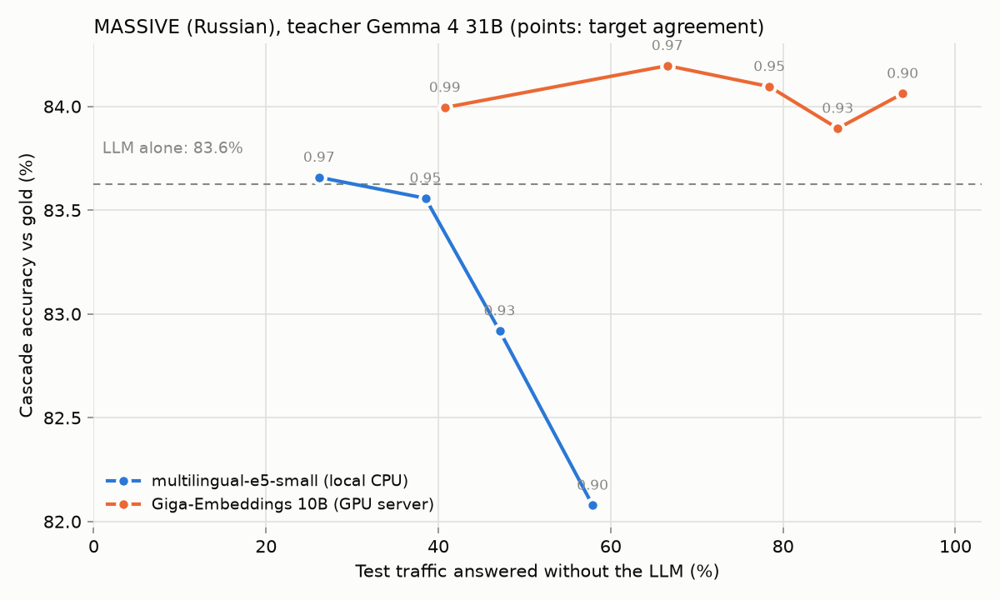

<p align="center">
  <picture>
    <source media="(prefers-color-scheme: dark)" srcset="https://raw.githubusercontent.com/BenFruit/bounded-distill/v0.1.1/assets/logo-dark.svg">
    
  </picture>
</p>

<p align="center">
  <a href="https://pypi.org/project/bounded-distill/"></a>
  <a href="https://pypi.org/project/bounded-distill/"></a>
  <a href="https://github.com/BenFruit/bounded-distill/actions/workflows/ci.yml"></a>
  <a href="https://github.com/BenFruit/bounded-distill/blob/main/LICENSE"></a>
  <a href="https://microsoft.github.io/pyright/"></a>
  <a href="https://github.com/astral-sh/ruff"></a>
</p>

Train a small, fast classifier on the labels your LLM already produced, and let it answer
only when it agrees with the LLM often enough, with a statistical guarantee. Everything else
goes back to the LLM.

Status: alpha. It works and is tested and benchmarked, but the API may change before 1.0.

## Why

A lot of text classification now runs through an LLM: a prompt, an API call, some output
parsing. It works, but each call is slow and costs money. The usual fix is to train a small
model on the LLM's own answers and fall back to the LLM when the small model is unsure.

Training the small model is the easy part. The hard part is deciding when to trust it. "It
looked fine on a validation set" is not a great reason to replace an LLM in production.

## What it does

You pass in texts with the labels your LLM gave them (from your logs, for example) and a
target like "agree with the LLM at least 97% of the time". The library then:

1. trains a small classifier: frozen sentence embeddings plus logistic regression;
2. picks a confidence threshold so that the lower confidence bound of agreement on the texts
   it answers meets your target, not just the average;
3. reports how much traffic the small model takes over, its agreement per class, and its
   latency;
4. lists suspects: texts where the small model is confident but disagrees with the LLM.
   These are often the LLM's own mistakes, or a sign that two classes in your prompt overlap;
5. checks accuracy against human labels, if you have some.

Texts below the threshold go to your LLM as before. The library itself never calls an LLM.

## Install

```bash
pip install bounded-distill
```

The default embedder runs on `sentence-transformers`, which needs PyTorch. Without a GPU,
install the CPU build of PyTorch first, it is much smaller:

```bash
pip install torch --index-url https://download.pytorch.org/whl/cpu
```

## Quickstart

```python
from bounded_distill import distill

# texts and the labels your LLM gave them
router = distill(texts, llm_labels, target_agreement=0.97)

if (label := router.predict(text)) is None:  # not confident enough
    label = my_llm_pipeline(text)

print(router.report())
for suspect in router.suspects(top_n=20):
    print(suspect)

router.save("router/")  # later: Router.load("router/")
```

`llm_labels` can contain `None` or empty strings, which is what failed calls and parsing
errors usually look like. Such texts are left out of training, counted in the report, and
you get a warning. Use `on_invalid="drop"` to silence it or `on_invalid="error"` to fail
instead. If you pass `labels=[...]`, any label outside that list is treated as invalid too.

The default embedder is `intfloat/multilingual-e5-small`: it handles many languages and runs
fine on a CPU. To use your own embeddings, pass `embed=`, a function that takes a list of
texts and returns an `(n, dim)` array.

## Reading the report

Here is a report on synthetic data with 3% wrong LLM labels and a 90% target. The data was
embedded with a fake embedder, which is why the latency is so low.

```
bounded-distill report
  texts:      900 total, 898 used, 2 invalid (1 missing (None), 1 empty)
  target:     agreement >= 90.0% at 95% confidence: reached
  threshold:  0.8218
  coverage:   53.6% (481 of 898 texts answered without the LLM)
  agreement:  92.3% on answered texts, lower bound 90.1%
  latency:    0.02 ms per text (median, student)

  per class  support  coverage  agreement
  billing        299     55.5%      95.8%
  other          297     52.2%      89.0%
  tech           302     53.0%      91.9%

  confident disagreements (LLM label -> student label)
  other -> tech         9
  other -> billing      8
  ...
```

Coverage is the share of texts the small model answers, which is also the share of LLM calls
you save. The lower bound is what the threshold is based on: with 95% confidence, agreement
on the answered texts is at least this high. If no threshold can reach the target, the
router doesn't answer anything and the report tells you so.

The per-class table shows what the total hides. Here the class `other` is below 90% even
though the overall number is above it. The disagreement list points at classes the LLM finds
hard to tell apart, and a catch-all class like `other` is the usual suspect.

All these numbers are out-of-fold: each text is scored by a model that didn't see it in
training. `print(report)` is meant for reading, `report.to_dict()` gives you plain JSON.

Suspects are single texts, most confident first. In this example 8 of the top 10 are labels
that were broken on purpose, even though broken labels make up only 18% of all
disagreements:

```
#90  tech -> billing (96.8%): 'billing 90'
#359  other -> tech (96.5%): 'tech 59'
```

The number in front is the text's position in your input, so you can find it in your data.

## Checking against human labels

Agreeing with the LLM is not the same as being right. If you have a few hundred texts with
human labels that weren't used for training, you can compare the LLM, the small model and
the two combined:

```python
print(router.evaluate(texts, gold_labels, llm_labels))
```

The small model only answers when it's confident, and those tend to be the easier texts. So
the report also shows the LLM's accuracy on exactly the texts the small model answered,
which is the fair comparison.

## Benchmark

I tested the library on two intent classification datasets that have human labels:

- Banking77: English banking questions, 77 intents, 10,003 train and 3,080 test texts;
- MASSIVE, Russian part: voice assistant commands, 59 intents, 11,510 train and 2,974 test
  texts.

Four LLMs labeled the texts, all self-hosted on vLLM: Gemma 4 31B, Qwen3-4B-Instruct,
gpt-oss-120b and Kimi-K2.6. Each got the list of label names in the prompt and had to answer
with one of them, no examples. Like any LLM in production, they make mistakes: their accuracy
against the human labels is 67% to 83% on Banking77 and 66% to 84% on MASSIVE.

The router was trained only on the LLM's labels for the train texts. The human labels were
used only at the end, to check the router on test texts it had never seen.

The charts and the first table use Gemma 4 31B.

<picture>
  <source media="(prefers-color-scheme: dark)" srcset="https://raw.githubusercontent.com/BenFruit/bounded-distill/v0.1.1/benchmarks/results/banking77_dark.png">
  
</picture>
<picture>
  <source media="(prefers-color-scheme: dark)" srcset="https://raw.githubusercontent.com/BenFruit/bounded-distill/v0.1.1/benchmarks/results/massive_ru_dark.png">
  
</picture>

Note that the y-axes are zoomed in. On these test sets, 0.3 points is about ten texts.

With `target_agreement=0.97`:

| Dataset | Embedder | Traffic without the LLM | Agreement with the LLM there | Accuracy of the combination | LLM alone |
|---|---|---|---|---|---|
| Banking77 | multilingual-e5-small (default) | 24.9% | 97.3% | 78.4% | 78.5% |
| Banking77 | Giga-Embeddings 10B (via `embed=`) | 76.1% | 97.7% | 79.3% | 78.5% |
| MASSIVE ru | multilingual-e5-small (default) | 26.2% | 96.9% | 83.7% | 83.6% |
| MASSIVE ru | Giga-Embeddings 10B (via `embed=`) | 66.6% | 97.3% | 84.2% | 83.6% |

All four LLMs with Giga-Embeddings and `target_agreement=0.97`, accuracy against the human
labels on test:

| LLM | Banking77: traffic without the LLM | Banking77: combination / LLM alone | MASSIVE ru: traffic without the LLM | MASSIVE ru: combination / LLM alone |
|---|---|---|---|---|
| Qwen3-4B-Instruct | 50.5% | 67.5% / 66.7% | 36.4% | 66.6% / 66.1% |
| Gemma 4 31B | 76.1% | 79.3% / 78.5% | 66.6% | 84.2% / 83.6% |
| Kimi-K2.6 | 74.8% | 81.0% / 80.3% | 66.9% | 83.8% / 82.8% |
| gpt-oss-120b | 79.4% | 83.9% / 82.9% | 59.5% | 80.5% / 79.2% |

One prediction takes about 13 ms with e5-small on a laptop CPU and 55 ms with
Giga-Embeddings on a GPU server, network included. One Gemma call took 117 ms.

What I took away from it:

- The bound holds on new data. Over 16 runs (4 LLMs, 2 datasets, 2 embedders) there are 75
  reachable targets. The test agreement was below the target in 18 of them, by up to 1.1
  points, but only once was it significantly below, which is fewer than the 5% that 95%
  confidence allows. The coverage measured on test was within 3.3 points of what the report
  predicted.
- The combination was a little more accurate than the LLM alone for every LLM and dataset,
  by 0.5 to 1.3 points at 0.97. The small model averages over similar texts and smooths out
  some of the LLM's random mistakes. With the weakest LLM this goes further: at 0.90 the small
  model answers 78% of Banking77 and the combination is 2.4 points more accurate than the LLM.
- The embedder matters most. With a stronger one the small model answers 2 to 6 times as
  much traffic at the same target.
- Suspects find real LLM mistakes. With Giga-Embeddings, 75 to 94 of the top 100 suspects were
  texts the LLM got wrong, for every LLM, while only 16% to 37% of all texts were. With
  e5-small and Gemma the numbers were lower, 39 and 55 out of 100.
- Many of the LLM's mistakes are consistent ones: 60% to 69% on Banking77 and 46% to 49% on
  MASSIVE, about the same for all four LLMs. The small model learns them and agrees with the
  LLM, so no agreement metric can catch them. You need human labels for that, which is what
  `evaluate()` is for.
- Not every "LLM mistake" is one. On 7% of the Banking77 train texts and 4% of the MASSIVE
  ones, all four LLMs chose the same label and the human label was different. Looking through
  some of them, most are ambiguous between two intents, and quite a few human labels are simply
  wrong. So accuracy against human labels understates how good all of these models are.

Some caveats. Both datasets are part of the MTEB benchmark, so embedding models may have been
trained on them; Giga-Embeddings doesn't publish its training data, so its numbers could be a
bit optimistic. Latency depends on hardware, and the LLM server used here is fast, so the main
saving is GPU time rather than wall time. Texts were embedded as they are, without the
instruction prefix that Giga-Embeddings recommends for classification.

Scripts to reproduce all of this are in
[benchmarks/](https://github.com/BenFruit/bounded-distill/blob/main/benchmarks/README.md).

## How it works

1. Embed the texts with a frozen sentence embedding model.
2. Train k logistic regressions with k-fold cross-validation, so every training text gets
   class probabilities from a model that didn't see it.
3. For each possible threshold, count the texts above it and how many of them agree with the
   LLM, and compute the one-sided Wilson lower bound for that agreement.
4. Take the lowest threshold whose bound reaches the target. Lowest means the most coverage.
5. To predict, average the probabilities of the k models. These are the same models the
   threshold was picked for, so it means the same thing on new texts. A prediction is one
   embedding and a few small matrix multiplications in numpy.

A saved router is a JSON file plus an `.npz` file. There is no pickle and no training text on
disk. The design and the reasoning behind it are in
[docs/design.md](https://github.com/BenFruit/bounded-distill/blob/main/docs/design.md).

## How it differs from similar tools

There are several projects that distill an LLM classifier into a small model with an LLM
fallback. This one is different in a few ways:

- it works offline, on labels you already have, and never runs or wraps the LLM;
- the threshold comes from a statistical bound instead of being picked by hand;
- it helps you audit the LLM: confident disagreements point at its labeling mistakes, in the
  spirit of Confident Learning (Northcutt et al., 2021);
- it is small: one function call, strict typing, few dependencies.

## Limitations

- Agreement with the LLM is not accuracy. If the LLM keeps making the same mistake, the
  small model learns it too. Check with human labels.
- The threshold is chosen and evaluated on the same out-of-fold data, so the bound is a bit
  optimistic. In the benchmark only 1 of 75 targets was significantly missed on new texts.
- Only single-label classification with a fixed set of labels.
- When the small model answers, you get just the label, not the other fields your pipeline's
  structured output may have.

## Roadmap

- [x] Core: `distill`, `Router.predict`, save and load
- [x] Report: coverage, agreement with a lower bound, per-class numbers, latency
- [x] Suspects
- [x] Evaluation against human labels
- [x] Benchmark on Banking77 and Russian MASSIVE with real LLM labels
- [x] Release 0.1.0 on PyPI
- [x] Four LLMs in the benchmark, and a check of the bound on new data
- [ ] Optional online mode that collects examples from a running pipeline

## Contributing

Issues and pull requests are welcome, see [CONTRIBUTING.md](https://github.com/BenFruit/bounded-distill/blob/main/CONTRIBUTING.md).
Changes between versions are listed in [CHANGELOG.md](https://github.com/BenFruit/bounded-distill/blob/main/CHANGELOG.md).

## License

Apache License 2.0, see [LICENSE](https://github.com/BenFruit/bounded-distill/blob/main/LICENSE)
and [NOTICE](https://github.com/BenFruit/bounded-distill/blob/main/NOTICE).
